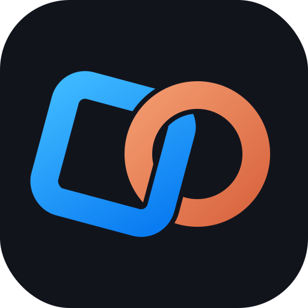

<p align="center"></p>
<h1 align="center">StudioLink</h1>
<p align="center">Ponte entre o Claude Code e o Roblox Studio.</p>

O Claude cria e edita o jogo direto no Studio: scripts sincronizados com arquivos `.luau` nos dois sentidos,
objetos criados por JSON na hora (Parts, Models, UI, luzes, efeitos), playtest controlado pelo terminal,
teste bruteforce (`fuzz`), modelos 3D pelo Blender e upload de assets pela Open Cloud. Sem dependências.

## Instalar (uma vez por PC)
1. Tenha o **Node.js 20+** e o **Roblox Studio**.
2. Clone este repositório (ex.: `C:\dev\StudioLink`) e dê dois cliques em **`install.cmd`**. Ele:
   - instala o comando `studiolink` (`npm install -g .`);
   - copia o plugin pra pasta de plugins do Studio;
   - registra o MCP no Claude Code pra todos os projetos.

## Usar (cada jogo)
```
cd C:\dev\MeuJogo
studiolink init          # cria studiolink.json (porta livre), src/, CLAUDE.md, start.cmd
studiolink start         # liga o servidor do projeto (deixe aberto) — ou dois cliques no start.cmd
```
No Studio, abra o place → aba **Plugins → StudioLink** → ponha a porta do `studiolink.json` → **Conectar**.
Depois é só abrir o Claude Code na pasta do jogo.

Vários Studios ao mesmo tempo: cada projeto tem a sua porta e o seu `studiolink start`.

## Comandos
```
studiolink status                     quem está conectado (edit / server / client)
studiolink create|set|get|delete|clone|export    objetos por JSON
studiolink run arquivo.luau | eval "código"      executa Luau no Studio
studiolink tree Workspace 2           hierarquia
studiolink play test|run|stop         playtest
studiolink logs 50                    Output do Studio
studiolink fuzz 40                    teste bruteforce com relatório
studiolink blender script.py          roda Python no Blender (biblioteca rbx)
studiolink upload modelo.fbx --insert sobe pro Roblox (Open Cloud) e insere
studiolink selftest                   testa a ponte inteira
studiolink restart                    recarrega o servidor do projeto
studiolink key                        salva a chave da Open Cloud
```
`studiolink help` lista tudo.

## Atualizar
Na pasta do StudioLink: edite, `git commit`, `git push` e rode o `install.cmd` de novo
(ele atualiza o plugin e o MCP). Nos projetos abertos: `studiolink restart`.

## Como funciona
```
Claude Code ──(MCP / studiolink)──► servidor do projeto (localhost:porta) ◄──(HTTP long-poll)── plugin no Studio
                                          │
                                         src/  ⇄  scripts do jogo
```
- Só aceita conexões locais e bloqueia requisições de navegador.
- Ao reconectar nada é apagado; versões em conflito vão pra `.bridge/backup/`.
- Upload de assets: crie uma User API Key em create.roblox.com → Open Cloud (permissão assets read + write) e rode
  `studiolink key` (salva no `.env` da pasta do StudioLink, fora do git, e vale pra todos os projetos).

## Estrutura
```
bin/studiolink.js      comando global (init, start, plugin, mcp + CLI)
bridge/server.js       servidor de cada projeto
bridge/cli.js          comandos de terminal
bridge/mcp.js          ferramentas MCP (studio_*, blender_run...)
bridge/blender/rbx.py  biblioteca de modelagem pro Blender
plugin/                plugin do Studio
template/              arquivos que o "studiolink init" cria
```
